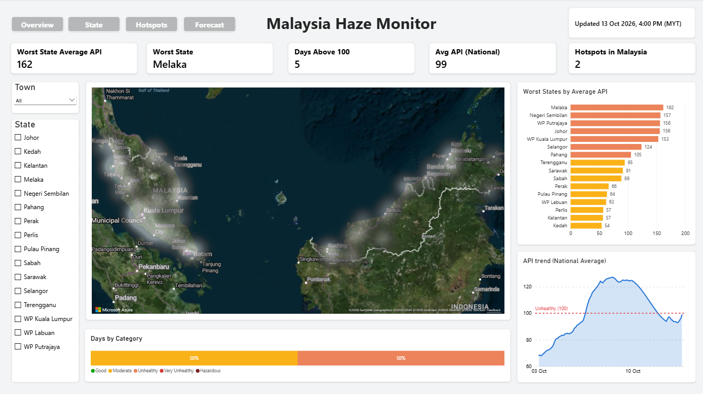

# Malaysia Haze Monitor

A Power BI dashboard tracking haze across Malaysia: air quality (API), regional fire hotspots, wind and rain and forecast.

**Live dashboard:** https://app.powerbi.com/view?r=eyJrIjoiMWJlNGM2NmEtNTc3YS00NzM1LWFmNzktOWM4YzFlZWZmNTljIiwidCI6IjBlMGRiMmFkLWM0MTYtNDdjNy04OGVjLWNlYWM0ZWU3Njc2NyIsImMiOjEwfQ%3D%3D

## What it shows
- **Overview:** national and state API, worst state, days above 100, hotspots in Malaysia
- **Stations:** hourly API, wind, rain and drift direction per station
- **Hotspots:** NASA FIRMS fire detections by region (Sumatra, Kalimantan, Malaysia, Thailand)
- **Forecast:** 5-day API forecast per station with an 80% range and the chance of API above 100

## How it works
- A GitHub Actions job runs **every hour** and appends new data to `data/`:
  - `collect.py`: Malaysian API readings from the DOE MyEQMS public API
  - `hotspots.py`: VIIRS hotspots from NASA FIRMS, labelled by region with `regions.geojson`
  - `forecast.py`: calibrates Open-Meteo/CAMS modelled PM2.5 against DOE API readings (per-station linear fit) to forecast API
- Power BI reads the CSVs from this repo and refreshes on a schedule.
- Wind, rain and modelled PM2.5 come directly from Open-Meteo.

## Data sources
- Department of Environment Malaysia (DOE), MyEQMS: air pollutant index
- NASA FIRMS: VIIRS active fire data
- Open-Meteo: weather and CAMS air-quality model data

## Disclaimer
Independent independent project. Not affiliated with DOE, NASA or Open-Meteo.

Built by Hollis Francis.
